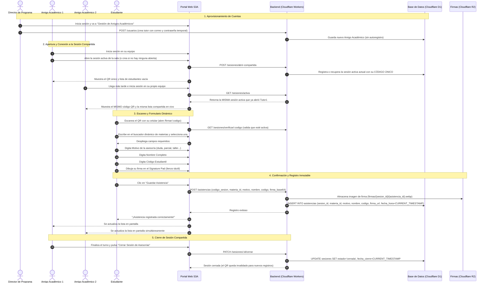
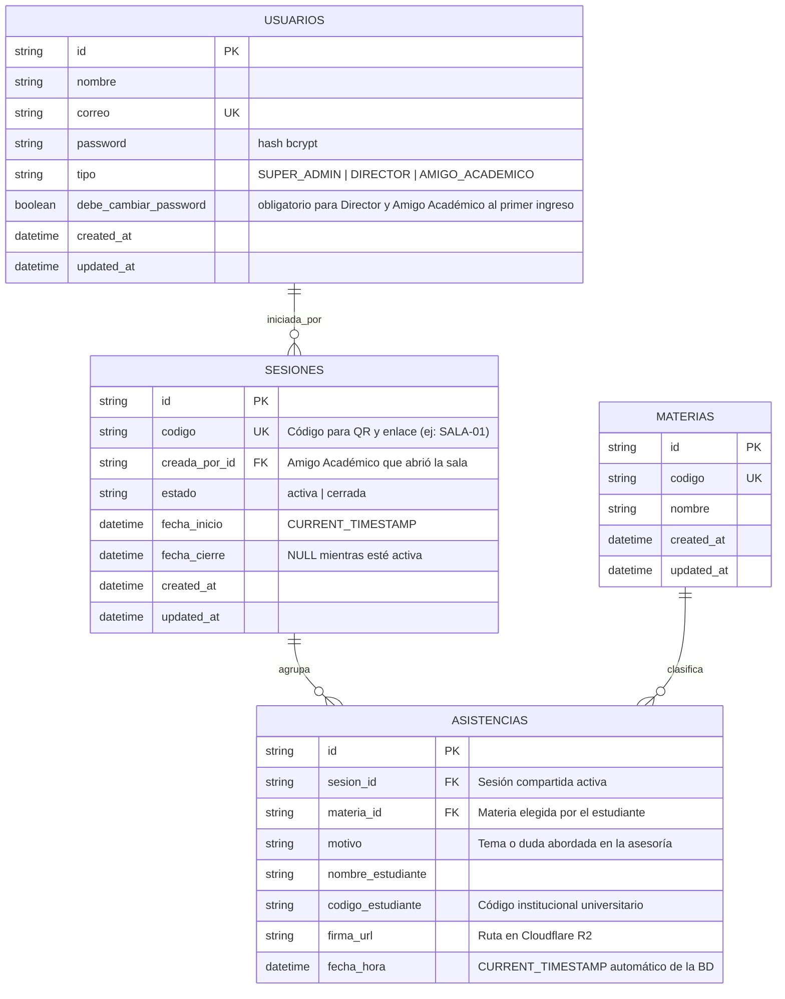

# 📌 ESPECIFICACIÓN Y CONTEXTO VIVO DEL PROYECTO: S3A
### Sistema de Asistencia Digital "Amigo Académico"

> [!IMPORTANT]
> ### ⚠️ MEMORIA CENTRAL Y FUENTE ÚNICA DE VERDAD DEL PROYECTO
> Este documento define la arquitectura, flujos operativos, modelo de datos y estado de implementación del sistema **S3A**. 
> Todo cambio en requerimientos o avance técnico debe reflejarse obligatoriamente aquí antes de proceder con modificaciones mayores de código.

---

## 1. Visión y Propósito del Proyecto

**S3A** es una plataforma web para digitalizar, controlar y auditar la asistencia de estudiantes a las tutorías y asesorías universitarias del programa **Amigo Académico**.

Sustituye por completo las planillas de papel por un flujo dinámico apoyado en un **único código QR de sala** y **firma digital manuscrita en pantalla (Signature Pad)** desde el celular del estudiante.

---

## 2. Roles del Sistema y Reglas de Cuentas

> **NO existe registro público (sign-up)** de ningún tipo. Todas las cuentas son aprovisionadas por autoridades académicas.

| Rol | ¿Cómo obtiene su cuenta? | Responsabilidades Principales |
|---|---|---|
| **SUPER_ADMIN** | Creado por base de datos / semilla inicial. | Gestión de Directores, configuración global del sistema y catálogo maestro. |
| **DIRECTOR** | Creado por un Super Admin. | **Crea y administra las cuentas de los Amigos Académicos** y el **catálogo de materias**. Consulta de asistencias, auditoría visual de firmas y exportación a Excel (`.xlsx`). |
| **AMIGO_ACADEMICO** | **Creado exclusivamente por un Director** (no hay autoregistro). | Inicia sesión, visualiza/activa la **sesión compartida de asesoría**, proyecta el **QR único de sala**, visualiza las asistencias en vivo y cierra la sesión al finalizar el turno. |
| **ESTUDIANTE** | **Sin cuenta ni credenciales**. | Escanea el QR proyectado, busca su materia en el formulario interactivo, ingresa motivo, nombre, código y plasma su firma digital. |

---

## 3. Dinámica de Sala: Sesión Única Compartida

### 3.1 Principio Operativo
- En el espacio o sala de asesorías puede haber **uno o varios Amigos Académicos en turno simultáneamente**.
- **No se crea una sesión por cada tutor**: Existe **1 sola sesión activa compartida** para la sala.
- **No se asocia el estudiante a un Amigo Académico específico**: Lo relevante para la institución es la constancia de asistencia del estudiante a la asesoría (materia, motivo, fecha/hora y firma).
- Si un Amigo Académico ya abrió la sesión:
  - Cualquier otro Amigo Académico que ingrese al sistema verá que ya hay una sesión activa en curso.
  - Ambos tienen en pantalla el **mismo código QR**, el mismo código corto y la **misma lista en vivo** de alumnos que van firmando.
- Cuando culmina el horario de atención, cualquiera de los Amigos Académicos en turno puede **dar por finalizada la sesión**, lo cual desactiva el QR para todos.

---

## 4. Flujo Operativo Integral (Paso a Paso)



---

## 5. Esquema de Entidades y Base de Datos (Cloudflare D1)



### Reglas Clave del Modelo:
1. **`asistencias` NO tiene `amigo_academico_id`**: La atención es grupal/institucional de sala.
2. **`sesiones.codigo` es único y compartido**: Identifica la jornada de atención activa para todos los tutores de turno.
3. **`asistencias.fecha_hora` automática**: `DEFAULT CURRENT_TIMESTAMP` para auditoría fidedigna.
4. **Almacenamiento de firmas**: Bucket de Cloudflare R2 (`db-sd3-r2`).

---

## 6. Especificación de Endpoints (API Backend)

### 6.1 Autenticación y Cuentas (`/auth` y `/usuarios`)
- `POST /auth/login` → Login para Directores, Super Admins y Amigos Académicos. Retorna JWT.
- `GET /usuarios` → Listar usuarios (solo `SUPER_ADMIN` y `DIRECTOR`). Los directores pueden ver y filtrar los Amigos Académicos.
- `POST /usuarios` → Creación de Amigo Académico exclusivamente por el **DIRECTOR** o **SUPER_ADMIN**.

### 6.2 Catálogo de Materias (`/materias`)
- `GET /materias` → Lista todas las materias (público / optimizado para el buscador del estudiante y paneles).
- `POST /materias` → Crear materia (`SUPER_ADMIN`, `DIRECTOR`).
- `PUT /materias/:id` → Modificar materia (`SUPER_ADMIN`, `DIRECTOR`).
- `DELETE /materias/:id` → Eliminar materia (`SUPER_ADMIN`, `DIRECTOR`).

### 6.3 Sesión Compartida de Sala (`/sesiones`)
- `GET /sesiones/activa` → Retorna la sesión activa actual de la sala (si existe), junto con su código y QR.
- `POST /sesiones/abrir` → Si no hay sesión activa, crea una nueva con código único. Si ya existe una activa, retorna la existente para sumarse a ella.
- `GET /sesiones/verificar/:codigo` → **Público**: Valida que la sesión del QR escaneado por el alumno siga activa.
- `GET /sesiones/:id/asistencias` → Retorna la lista en vivo de estudiantes registrados en la sesión.
- `PATCH /sesiones/:id/cerrar` → Finaliza la sesión compartida (invalida el QR).

### 6.4 Registro de Asistencias del Estudiante (`/asistencias`)
- `POST /asistencias` → **Público**:
  - Parámetros: `codigo_sesion`, `materia_id`, `motivo`, `nombre_estudiante`, `codigo_estudiante`, `firma_base64`.
  - Guarda la imagen de la firma en R2 (`FIRMAS_BUCKET`).
  - Inserta en D1 con fecha/hora automática.
- `GET /firmas/:asistencia_id` → Visualización segura de la firma en R2 (para auditoría).

- `GET /reportes/asistencias` → Consulta general con filtros: rango de fechas, materia, código o nombre de estudiante.
- `GET /reportes/excel` → Descarga del consolidado en formato `.xlsx` con las 8 columnas requeridas y todas las firmas manuscritas incrustadas directamente en cada fila.

---

## 7. Plan de Implementación Técnica Inmediato

1. **Base de Datos (`backend/src/db/schema.sql`)**:
   - Ajustar tablas a: `materias`, `usuarios`, `sesiones` (compartida) y `asistencias`.
2. **Tipos TypeScript (`backend/src/types/index.ts`)**:
   - Reflejar los nuevos modelos y DTOs exactos.
3. **Servicios y Rutas de Backend**:
   - `sesionService.ts` y `sesiones.ts`: Lógica de sesión compartida única (`abrir`, `activa`, `verificar`, `cerrar`).
   - `asistenciaService.ts` y `asistencias.ts`: Formulario público, subida a R2 y registro en D1.
   - `auth.ts`: Login con JWT y permisos para que los directores creen amigos académicos.

---

## 8. Usuarios de Prueba (Seed Inicial — D1)

> [!IMPORTANT]
> Estas credenciales están insertadas en la base de datos D1 mediante `backend/src/db/seed.sql`.
> Las contraseñas se almacenan en formato **PBKDF2-SHA256** con 100.000 iteraciones, usando la misma lógica de `backend/src/utils/passwordHash.ts`.

| Rol | Nombre | Correo | Contraseña | `debe_cambiar_password` |
|---|---|---|---|---|
| `SUPER_ADMIN` | Super Admin | `admin@s3a.edu.co` | `Admin2025!` | `false` |
| `DIRECTOR` | Director de Programa | `director@s3a.edu.co` | `Director2025!` | `false` |
| `AMIGO_ACADEMICO` | Amigo Académico Prueba | `amigo@s3a.edu.co` | `Amigo2025!` | `false` |

### Cómo regenerar / aplicar el seed

```bash
# Aplicar a la BD LOCAL (desarrollo con wrangler dev):
cd backend
npx wrangler d1 execute db-sd3-d1 --local --file=./src/db/seed.sql

# Aplicar a la BD REMOTA (Cloudflare D1 en producción):
cd backend
npx wrangler d1 execute db-sd3-d1 --remote --file=./src/db/seed.sql
```

> [!CAUTION]
> Si los IDs `usr-seed-001`, `usr-seed-002`, `usr-seed-003` ya existen en la BD, el INSERT fallará con un error de PRIMARY KEY.
> En ese caso borra previamente los registros o usa el script de reset antes de aplicar el seed.
