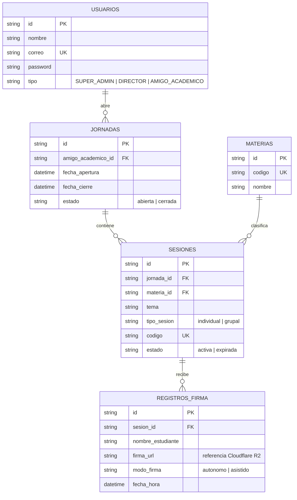

# 📌 CONTEXTO VIVO DEL PROYECTO: S3A (Sistema de Asistencia Digital "Amigo Académico")

> [!IMPORTANT]
> ### ⚠️ INSTRUCCIÓN OBLIGATORIA PARA AGENTES Y MODELOS DE IA
> **ESTE DOCUMENTO ES LA MEMORIA CENTRAL Y FUENTE ÚNICA DE VERDAD DEL PROYECTO.**
> Todo asistente, agente o modelo de IA que trabaje en este repositorio **DEBE LEER ESTE ARCHIVO AL INICIAR** y **DEBE ACTUALIZARLO OBLIGATORIAMENTE AL FINALIZAR CUALQUIER CAMBIO O INTERVENCIÓN**.
> 
> **Cada actualización debe reflejar:**
> 1. Nuevo estado de los módulos y componentes desarrollados.
> 2. Nuevos endpoints creados, rutas y migraciones de base de datos.
> 3. Tareas completadas vs. tareas pendientes.
> 4. Decisiones de diseño, convenciones técnicas o dependencias añadidas.
> 5. Próximo paso exacto para que el siguiente modelo o desarrollador continúe sin perder contexto.

---

## 1. Visión y Propósito del Proyecto

**S3A** es una plataforma web para modernizar, digitalizar y auditar el control de asistencias a las tutorías y asesorías del programa universitario **Amigo Académico**.
Sustituye las listas físicas en papel por un flujo digital apoyado en **firma electrónica manuscrita capturada en pantalla (Signature Pad)**, códigos únicos/QR de sesión y almacenamiento seguro en la nube.

### Flujo Operativo Central:
1. **Jornada de Trabajo**: El tutor (*Amigo Académico*) inicia sesión y "Abre Jornada" al comenzar su turno de beca.
2. **Sesión de Asesoría**: Dentro de una jornada activa, el tutor crea una o varias sesiones especificando materia (del catálogo oficial precargado) y tema abordado. Se define si es `individual` o `grupal`.
3. **Código / QR de Sesión**: El sistema genera un identificador corto y su respectivo código QR.
4. **Firma Digital**:
   - **Modo Autónomo**: El estudiante escanea el QR o entra el código desde su celular (sin requerir cuenta ni login), visualiza los datos de la sesión, escribe su nombre (en sesiones grupales) o confirma el precargado (en sesiones individuales) y plasma su firma gráfica.
   - **Modo Asistido**: Si el estudiante no dispone de celular o conectividad, el Amigo Académico activa la pantalla de firma en su propio equipo para que el estudiante firme allí mismo.
5. **Cierre de Jornada**: Al concluir el turno, el tutor cierra la jornada. En ese instante, todos los códigos y accesos a firmas de esa jornada quedan **automáticamente invalidados/expirados**.
6. **Auditoría y Reportes**: Directores y Super Admins pueden filtrar asistencias con múltiples criterios y exportar consolidados a Excel (`.xlsx`).

---

## 2. Pila Tecnológica (Stack) y Arquitectura

| Capa | Tecnología | Rol / Justificación |
|---|---|---|
| **Backend Framework** | **Cloudflare Workers + Hono (TypeScript)** | Serverless ultrarrápido, edge computing, API REST minimalista y modular. |
| **Base de Datos** | **Cloudflare D1 (SQLite en Edge)** | Datos relacionales (usuarios, materias, jornadas, sesiones, asistencias). |
| **Almacenamiento de Archivos** | **Cloudflare R2 (S3-compatible Object Storage)** | Almacenamiento binario de las imágenes de las firmas digitales (`.png`/`.webp`). |
| **Autenticación** | **JWT (JSON Web Tokens)** | Claims de roles (`SUPER_ADMIN`, `DIRECTOR`, `AMIGO_ACADEMICO`). Los estudiantes NO tienen login. |
| **Frontend** | **React / Vite + TypeScript + Tailwind CSS** *(planificado)* | SPA ágil, mobile-first para la interfaz de firma del estudiante y panel administrativo responsivo. |
| **Librería de Firma** | **`signature_pad`** *(HTML5 Canvas)* | Captura táctil suave y vectorizada de la firma del estudiante. |
| **Exportación** | **SheetJS (`xlsx`)** | Generación de reportes de auditoría en formato Excel. |

---

## 3. Estado Actual de la Base de Código (Snapshot Actual)

### 3.1 Estructura en el Repositorio
```text
/home/ing-mapache/Proyectos/S3A/
├── README.md                     <- Descripción básica del proyecto
├── CONTEXTO_PROYECTO.md          <- [ESTE DOCUMENTO] Memoria viva del proyecto
└── backend/
    ├── package.json              <- Hono v4.13.11, wrangler v4.143.1, typescript v7.0.2
    ├── tsconfig.json             <- Configuración TypeScript ESNext / NodeNext
    ├── wrangler.jsonc            <- Configuración de Cloudflare Workers
    ├── AGENTS.md                 <- Documentación técnica Cloudflare Workers
    └── src/
        ├── index.ts              <- Servidor Hono con CORS y montaje de rutas (/materias, /usuarios)
        ├── db/
            └── schema.sql        <- Tablas 'materias' y 'usuarios' con datos semilla (Parcial)
        ├── middlewares/
            └── auth.ts           <- authMiddleware y requireRole con fallback de tokens mock y headers
        ├── routes/
            ├── materias.ts       <- CRUD completo implementado (GET, POST, PUT, DELETE)
            ├── usuarios.ts       <- CRUD completo implementado protegido con SUPER_ADMIN
            ├── auth.ts           <- Archivo creado, PENDIENTE de implementación
            ├── jornadas.ts       <- Archivo creado, PENDIENTE de implementación
            ├── sesiones.ts       <- Archivo creado, PENDIENTE de implementación
            ├── firmas.ts         <- Archivo creado, PENDIENTE de implementación
            └── reportes.ts       <- Archivo creado, PENDIENTE de implementación
        ├── services/
            ├── materiaService.ts <- Lógica con soporte dual (D1 Database + fallback memoria)
            ├── usuarioService.ts <- Lógica con soporte dual (D1 Database + fallback memoria)
            ├── jornadaService.ts <- Archivo creado, PENDIENTE de implementación
            ├── sesionService.ts  <- Archivo creado, PENDIENTE de implementación
            └── firmaService.ts   <- Archivo creado, PENDIENTE de implementación
        └── types/
            └── index.ts          <- Tipos base (Role, Materia, Usuario, AuthUserPayload, Variables)
```

### 3.2 Avance Funcional Específico
- ✅ **Módulo 4: CRUD de Materias**: 100% completado en Backend (`routes/materias.ts` + `services/materiaService.ts`). Valida código y nombre.
- ✅ **Módulo 5: CRUD de Usuarios**: 100% completado en Backend (`routes/usuarios.ts` + `services/usuarioService.ts`). Protegido con RBAC para `SUPER_ADMIN`.
- ⚠️ **Módulo 1: Autenticación**: Mock provisional en `middlewares/auth.ts` (acepta tokens `Bearer director`, `Bearer amigo`, etc. y headers `X-User-Role`). Falta endpoint formal `POST /auth/login` con generación/verificación JWT y hash de contraseñas.
- ⏳ **Base de Datos D1**: `schema.sql` tiene `materias` y `usuarios`. Falta añadir `jornadas`, `sesiones` y `registros_firma`.
- ⏳ **Wrangler Bindings**: Falta configurar bindings `[[d1_databases]]` y `[[r2_buckets]]` en `wrangler.jsonc`.
- ⏳ **Módulo 2: Jornadas y Sesiones**: Archivos creados pero vacíos.
- ⏳ **Módulo 3: Firma Electrónica**: Archivos creados pero vacíos. Falta conexión a R2.
- ⏳ **Módulo 6: Consultas y Reportes**: Archivos creados pero vacíos.
- ⏳ **Frontend**: Aún no inicializado en el repositorio.

---

## 4. Esquema de Entidades y Datos



---

## 5. Matriz de Asignación por Perfil de Desarrollador

| Módulo / Componente | Desarrollador Asignado | Justificación y Enfoque |
|---|---|---|
| **Esquema D1 + Autenticación Base (JWT)** | **Ambos (Pair Programming)** | Cimiento crítico de seguridad y consistencia relacional. Ambos deben dominar el modelo. |
| **CRUD de Materias (Backend + Frontend)** | **Desarrollador Sin Experiencia (Junior)** | *(Backend ya hecho)* Ideal para practicar el patrón CRUD completo sin complejidad de estado. |
| **CRUD de Usuarios (Backend + Frontend)** | **Desarrollador Sin Experiencia (Junior)** | *(Backend ya hecho)* Refuerzo directo del patrón CRUD y gestión de formularios de administración. |
| **Jornadas y Sesiones (Backend + Frontend)** | **Desarrollador Con Experiencia (Senior)** | Lógica central del sistema, generación de códigos únicos, control de ciclos de vida y expiración. |
| **Firma Digital (R2 + Canvas + Asistido)** | **Desarrollador Con Experiencia (Senior / Pareja)** | Manejo de blobs binarios en Cloudflare R2, integración con canvas móvil y bloqueo de inmutabilidad. |
| **Consultas, Filtros Dinámicos y Excel** | **Ambos (Junior en Frontend / Senior en Backend)** | Backend: queries dinámicas complejas. Frontend: UI de filtros, paginación y exportación con SheetJS. |

---

## 6. Próximos Pasos Prioritarios (Checklist Inmediato)

1. [ ] **Completar `backend/src/db/schema.sql`**: Agregar tablas `jornadas`, `sesiones` y `registros_firma` con sus índices y llaves foráneas.
2. [ ] **Configurar `wrangler.jsonc`**: Añadir los bindings para D1 (`DB`) y R2 (`FIRMAS_BUCKET`).
3. [ ] **Implementar `routes/auth.ts`**: Endpoint `POST /auth/login` con JWT real y verificación de credenciales.
4. [ ] **Implementar Módulo de Jornadas y Sesiones**: `jornadaService.ts`, `sesionService.ts`, y sus rutas asociadas con generación de códigos no colisionables.
5. [ ] **Implementar Módulo de Firma**: `firmaService.ts` conectando R2 y D1, y validación estricta de estado activo.
6. [ ] **Inicializar Frontend**: Crear app cliente con React + Vite + TypeScript en `/frontend`.

---
*Última actualización: 2026-09-30 — Configuración inicial del contexto y análisis de código existente.*
